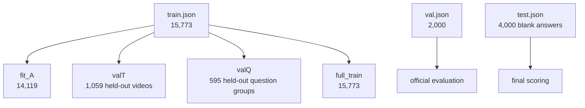
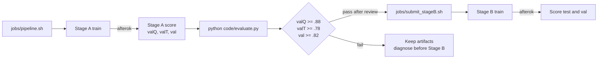
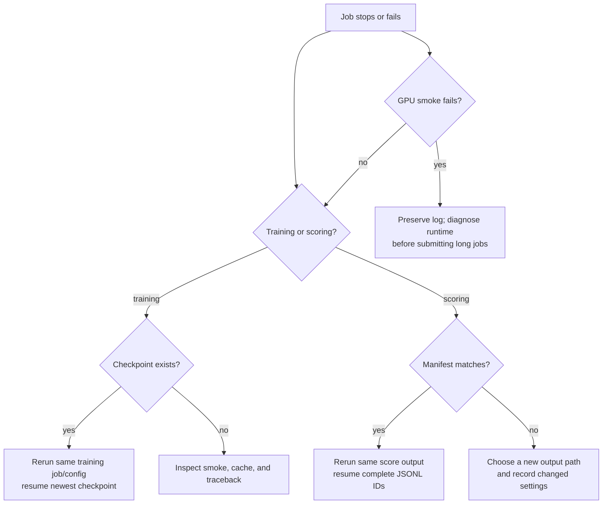

# ReVA experiment pipeline

ReVA is a four-choice video question answering experiment for drone footage.
Each question points to one clip, contains options `A` through `D`, and expects
one option letter. This repository contains the source code, configurations,
Slurm jobs, tests, and experiment documentation. It does **not** contain the
dataset, model weights, Hugging Face cache, checkpoints, score files, or
submissions.

The pipeline measures a small, reproducible Qwen3-VL-8B LoRA experiment before
spending time on the full training run. It validates data provenance and split
isolation, checks the GPU path with a short smoke run, trains Stage A, scores
three labelled holdouts, and submits Stage B only after an explicit accuracy
gate.

## Experiment hypothesis

The first experiment tests whether a frozen Qwen3-VL vision tower plus a small
language-only LoRA adapter can learn the answer format and improve over the
zero-shot model on ReVA holdouts. The fast-first settings are chosen to make a
real H200 measurement before any larger recipe is attempted:

| Setting | Value | Reason |
| --- | --- | --- |
| Backbone | `Qwen/Qwen3-VL-8B-Instruct` | Pinned multimodal base model |
| Model revision | `0c351dd01ed87e9c1b53cbc748cba10e6187ff3b` | Reproducible weights and processor |
| Adapter | LoRA `r=16`, `alpha=32`, dropout `0.05` | Small trainable state |
| LoRA targets | Language-model attention and MLP linear layers | Vision tower stays frozen |
| Frames | Up to 16, sampled at up to 4 fps | Bounded visual cost |
| Precision | bf16 | H200 training and inference path |
| Attention | PyTorch SDPA | Available fallback without extra packages |
| Training | 2 epochs, micro-batch 1, accumulation 16 | Effective batch 16 |
| TTA | Offsets `0` and `0.5`; two cyclic option orders | Four forwards per question |

FlashAttention and vLLM are not required. The installed Transformers processor
is shared by training and scoring so that the model sees the same prompt and
video metadata in both paths. The training log reports the measured step time
at steps 1, 5, and 50; use that estimate instead of a guessed wall-clock time.

## Pipeline overview

```mermaid
flowchart LR
    S[Source checkout] --> R[Runtime WORK tree]
    R --> D[Download pinned JSON and clips]
    D --> M[Build video manifest]
    M --> P[Build fit_A, valT, valQ, full_train]
    P --> G[GPU smoke probe]
    G --> A[Stage A train on fit_A]
    A --> AS[Stage A score: valQ, valT, val]
    AS --> E[Evaluate holdouts]
    E --> Q{Gate passes?}
    Q -->|yes| B[Stage B train on full_train]
    Q -->|no| I[Inspect metrics and artifacts]
    B --> BS[Score test and val]
    BS --> Z[Validate and package submission]
```



## Data and split design

The pinned dataset revision is `06224fa1b42e5e35677a8b7f2145e06307a9a4ee` from
`ReVA-Benchmark/ReVA`. The released counts are:

| Source | Questions | Role |
| --- | ---: | --- |
| `train.json` | 15,773 | Only source used to create local training and holdouts |
| `val.json` | 2,000 | Official labelled evaluation |
| `test.json` | 4,000 | Hidden-label submission set |
| Referenced clips | 1,047 | Downloaded by allow-list |

`make_splits.py` uses seed `0` and starts only from `train.json`:

| Split | Questions | Isolation rule |
| --- | ---: | --- |
| `fit_A` | 14,119 | Training source |
| `valT` | 1,059 | Held-out video groups |
| `valQ` | 595 | Held-out `(video, question)` groups |
| `full_train` | 15,773 | All train questions for Stage B |

The script checks unique IDs, disjoint IDs, disjoint `valT` videos, and
disjoint `valQ` question groups. `val.json` is never copied into a training
split. Test video overlap with training videos is expected; test questions and
answers are not training records.



`download_data.py` downloads the three JSON files, computes the exact clip
allow-list from their `video_path` fields, rejects unsafe paths, and downloads
only those clips. It also rejects unreferenced raw `DJI_*.MP4` files. The
resulting `data/dataset_revision.json` records the dataset commit. Before
training, `build_manifest.py` decodes every referenced clip and records frame
count, fps, width, height, and duration. A missing or corrupt clip stops the
run before GPU work begins.

## Source and runtime trees

Keep the Git checkout small and put runtime state on the shared filesystem.
`WORK` below is an example; use the path assigned to your account.

```text
ReVA/                         Git source checkout
  code/                       Python pipeline
  code/configs/               Stage A and Stage B YAML
  jobs/                       Slurm wrappers and dependencies
  tests/                      Login-node checks
  requirements*.txt           Pinned Python dependencies
  README.md                   This runbook

$WORK/                        Runtime tree, outside Git
  code/ jobs/ tests/          Copied source used by jobs
  data/ReVA/                  train.json, val.json, test.json, clips
  data/manifest.json         Decoded clip metadata
  data/splits/                fit_A, valT, valQ, full_train JSON
  data/dataset_revision.json Dataset provenance record
  hf_cache/                   Offline model and processor cache
  envs/reva/                  Python virtual environment
  runs/stageA_q3vl8b_r16/    Stage A checkpoints, adapter, scores
  runs/stageB_q3vl8b_r16/    Stage B checkpoints, adapter, scores
  logs/ subs/                Optional logs and submission zips
```

The repository `.gitignore` excludes data, runs, logs, submissions, caches,
Python bytecode, and common credential files. Inspect `git status` before every
commit. Never commit model weights, adapters, score files, credentials, or
dataset clips.

## Prerequisites and setup

The commands below assume a login node and an H200 Slurm partition named
`gpu_h200_8`. The H200 QOS permits **12 CPUs per user**; both checked-in GPU
job scripts request exactly 12 CPUs.

### 1. Create the runtime tree and environment

```bash
git clone https://github.com/Soham-47/ReVA.git
cd ReVA
export WORK=/scratch/ambpdc/soham/ReVA
mkdir -p "$WORK"/{data,hf_cache,runs,logs,subs,code,jobs,tests,envs}
cp -a code jobs tests requirements.txt requirements-torch.txt "$WORK/"

/apps/Amber24/amber24/miniconda/bin/python3.12 -m venv "$WORK/envs/reva"
source "$WORK/envs/reva/bin/activate"
python -m pip install --upgrade pip
python -m pip install -r "$WORK/requirements-torch.txt"
python -m pip install -r "$WORK/requirements.txt"
```

Check the driver from a short allocation before selecting a CUDA wheel:

```bash
srun -p gpu_h200_8 --gres=gpu:nvidia_h200_nvl:1 -c 12 -t 0:05:00 \
  nvidia-smi --query-gpu=name,driver_version --format=csv
```

`requirements-torch.txt` pins the tested Torch and torchvision versions. If the
cluster driver requires a different CUDA wheel index, install the compatible
wheel first and then install the remaining requirements. Do not install
FlashAttention or vLLM unless a separate, recorded benchmark proves that the
installed versions work with the pinned model.

### 2. Populate and validate data

```bash
export HF_HOME="$WORK/hf_cache"
export HF_HUB_ENABLE_HF_TRANSFER=0
hf download Qwen/Qwen3-VL-8B-Instruct \
  --revision 0c351dd01ed87e9c1b53cbc748cba10e6187ff3b

cd "$WORK"
python code/download_data.py
python code/build_manifest.py
python code/make_splits.py
```

The commands are safe to rerun after a failed download. `build_manifest.py`
uses strict released counts by default. For a deliberately smaller fixture,
use `--allow-count-drift` and record that the resulting run is not the released
experiment.

### 3. Run login-node checks

```bash
python3 -m unittest discover -s tests -v
python3 -m py_compile code/*.py
bash tests/test_jobs.sh
bash -n jobs/*.sbatch jobs/*.sh
```

These checks do not load the model or decode the dataset. They cover pure
sampling, option remapping, split safety, score resume behavior, submission
validation, job syntax, accepted H200 GRES syntax, 12-CPU requests, and the
smoke-before-training guard.

## GPU smoke probe

Run the probe in a short H200 allocation before submitting the long job:

```bash
srun -p gpu_h200_8 --gres=gpu:nvidia_h200_nvl:1 -c 12 --mem=64G \
  -t 0:15:00 --pty bash
source "$WORK/envs/reva/bin/activate"
export HF_HOME="$WORK/hf_cache"
export HF_HUB_OFFLINE=1 TRANSFORMERS_OFFLINE=1 TOKENIZERS_PARALLELISM=false
cd "$WORK"
python code/smoke.py
```

The probe loads the pinned processor and model, checks that `A` through `D`
are distinct single tokenizer tokens, encodes representative source samples,
includes the largest native sample, performs finite bf16 forward and backward
passes, and prints elapsed time and peak memory. A failed probe is a runtime
compatibility failure. Stop there, preserve its log, and fix or replace the
runtime before submitting training.

### Current CUDA incident

This branch records the confirmed state of the active recovery investigation so
that a new operator does not mistake an unverified workaround for a decision:

* H200 diagnostic **390242** reached the model forward pass with Torch
  `2.14.1+cu126`, Transformers `5.19.0`, capability `sm90`, and CUDA metadata
  on device. It failed at the Qwen3-VL line
  `image_grid_thw.prod(-1).tolist()` with `CUDA driver error: invalid argument`.
* Diagnostic **390243** disabled cuDNN SDPA and failed at the same line.
* Probe **390254** keeps the video grid metadata on CPU and is pending scheduler
  resources.

The root cause is **not proven**. Do not copy a provisional attention or device
workaround into this branch based on these IDs. Reproduce the smallest failing
operation, compare metadata-device and attention variants, add a regression
guard, and rerun the complete smoke forward/backward before resubmitting Stage
A. The active recovery tree and jobs are intentionally outside this branch.

## Stage A: benchmark and score the fast recipe

From the runtime tree, submit training and dependent holdout scoring together:

```bash
cd "$WORK"
bash jobs/pipeline.sh
```

The helper prints two job IDs. It submits:

```text
train.sbatch code/configs/stageA.yaml
  afterok
score.sbatch runs/stageA_q3vl8b_r16/final_adapter valQ valT val
```

The score job starts only after training succeeds. Both jobs request one H200,
12 CPUs, and use the offline cache under `$WORK/hf_cache`.



Training writes checkpoints under the configured `output_dir` every 300
optimizer steps and resumes from the newest `checkpoint-*`. It writes
`final_adapter/` and `DONE` only after successful completion. The batch job
uses a `STOP` file when Slurm sends `USR1`, requests a checkpoint, and requeues
the same job. A smoke marker prevents repeating a passed probe after recovery.

Scoring defaults to two offsets and two cyclic option orders. It performs four
forward passes per question, remaps displayed positions to original letters,
averages the four probability vectors, and writes one JSON record at a time.
The output manifest records model and dataset revisions, split checksum,
adapter checksum, TTA settings, and shard settings. A stopped scorer resumes
completed IDs after validating that manifest. Choose a new output path when
changing the adapter, split, offsets, rotations, or shard layout.

Evaluate all labelled references after the dependent score job finishes:

```bash
for split in valQ valT val; do
  python code/evaluate.py \
    "runs/stageA_q3vl8b_r16/scores_${split}.jsonl" "$split"
done
```

Review overall accuracy, single-view accuracy, per-task/source breakdowns,
confusion counts, and worst-task error CSVs. The Stage A gate is an engineering
target for deciding whether to spend the Stage B cost:

```text
valQ >= 0.88, valT >= 0.78, and official val >= 0.82
```

These thresholds are not claims about hidden test accuracy. `submit_stageB.sh`
reruns evaluation and refuses to submit if any file or threshold is missing.

## Stage B and submission

After reviewing the Stage A artifacts and confirming the gate:

```bash
bash jobs/submit_stageB.sh
```

This submits full-train (`full_train.json`) training and, after successful
training, dependent scoring for `test` and `val`. Once test scoring is complete:

```bash
python code/make_submission.py \
  --scores runs/stageB_q3vl8b_r16/scores_test.jsonl \
  --out subs/stageB_tta
```

The submission tool requires exactly 4,000 unique test IDs, finite probability
vectors that sum to one, valid predicted letters, and no extreme letter bias.
It reopens each zip after writing it. The primary zip contains
`predictions.json`; `_alt_list.zip` and `_alt_dict.zip` are small schema probes
for a platform format that is not documented in this repository. Confirm the
platform schema before submitting.

## Script guide

| Script | Inputs | Outputs | Main failure or recovery behavior |
| --- | --- | --- | --- |
| `download_data.py` | Dataset revision, `$WORK` | JSONs, allow-listed clips, revision record | Rejects unsafe paths, missing clips, unreferenced raw DJI files |
| `build_manifest.py` | Three JSONs, clips, revision record | `data/manifest.json` | Checks counts, schemas, IDs, paths, and every video decode |
| `make_splits.py` | `train.json`, seed, fractions | Four split JSONs | Checks ID/video/question-group disjointness |
| `smoke.py` | `fit_A`, manifest, offline model cache | Console probe output | Fails before long training on invalid GPU/model/processor behavior |
| `train.py` | Stage YAML, split JSON, manifest, cache | Checkpoints, adapter, `DONE` | Resumes newest checkpoint; validates train-only IDs and max tokens |
| `score.py` | Adapter, split, TTA, manifest, cache | JSONL scores and manifest | Resumes complete records; refuses manifest mismatch or corrupt JSONL |
| `evaluate.py` | Scores and one labelled split | Summary JSON, evaluation CSVs, worst-task CSV | Rejects unknown, duplicate, incomplete, or malformed IDs |
| `make_submission.py` | Test JSON and one or more score files | Validated primary and alternative zips | Rejects missing IDs, bad probabilities, invalid letters, suspicious bias |
| `jobs/pipeline.sh` | `$WORK` | Stage A train and dependent score jobs | Requires Slurm and a successful Stage A dependency |
| `jobs/submit_stageB.sh` | Stage A score artifacts | Stage B train and dependent score jobs | Re-evaluates and enforces the Stage A gate |
| `jobs/wait_child.sh` | Child PID | Shell wait result | Retries an interrupted `wait` without hiding child exit status |

## Monitoring and recovery

Record the IDs printed by the submit helper. Inspect only those jobs:

```bash
squeue -j <train_id>,<score_id>
sacct -j <train_id>,<score_id> \
  --format=JobID,State,Elapsed,MaxRSS,ExitCode
tail -f "$WORK/reva_train_<train_id>.out"
tail -f "$WORK/reva_score_<score_id>.out"
```



For a Slurm timeout, the job's `USR1` handler writes `STOP`, lets the child
finish its checkpoint or score record, and requeues. For a manual interruption,
inspect `sacct` and the latest checkpoint or JSONL record before rerunning.
Do not delete a checkpoint directory while a dependent score job is pending.
Do not mix score manifests from different adapters or TTA settings.

## Artifacts and reproducibility

The important provenance records are:

* `data/dataset_revision.json`: dataset repository, commit, and clip count.
* `data/manifest.json`: decoded clip dimensions and frame metadata.
* `data/splits/*.json`: deterministic split metadata and rows.
* `runs/*/checkpoint-*`: resumable Trainer state.
* `runs/*/final_adapter/`: LoRA weights and saved processor.
* `runs/*/scores_*.jsonl.manifest.json`: model, dataset, split, adapter, TTA,
  and shard checksums.
* `runs/*/*_summary.json`, `*_eval.csv`, `*_errors_worst3.csv`: evaluation
  results and inspectable failures.

The model revision, dataset revision, split checksum, adapter checksum, and
TTA settings are recorded or derivable from these files. Reproducibility still
depends on the pinned Python packages, CUDA driver, GPU type, and the exact
runtime cache. Keep logs beside the corresponding job ID.

## Git workflow

Source changes belong in Git; runtime artifacts stay under `$WORK` and remain
ignored. Before committing:

```bash
git status --short
git diff --check
python3 -m unittest discover -s tests -v
python3 -m py_compile code/*.py
bash tests/test_jobs.sh
git add code jobs tests README.md requirements*.txt .gitignore
git commit -m "describe one coherent change"
git push origin main
```

Keep behavior changes and documentation changes in separate commits. For a
review branch, push that branch and open a pull request without deploying it
to the runtime tree until it has been reviewed.

## Known limits

* This is one model and one fast-first LoRA recipe. No extra model ensemble is
  included.
* Video scoring is intentionally one question at a time because encoded visual
  tensors have variable lengths; TTA is reduced before any larger experiment.
* The official submission schema is not documented here; use the generated
  format probes and platform instructions.
* Accuracy, memory, and wall-clock estimates are measured outcomes. The 50-step
  benchmark is the first useful estimate for a particular node and software
  stack.
* The current CUDA incident above is unresolved in this branch. A future fix
  must include a focused regression check and a real-H200 finite
  forward/backward smoke result before Stage A is resubmitted.
