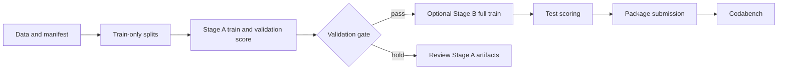

# ReVA experiment pipeline

This repository contains the reproducible source pipeline for the ReVA Drone
Video Understanding Challenge. It trains and scores one Qwen3-VL-8B-Instruct
LoRA adapter, evaluates private train-only holdouts, and packages a validated
test submission. The checkout contains source only. Dataset files, model
weights, Hugging Face caches, checkpoints, score files, and submissions stay
under `WORK` on Sharanga.

## Experiment at a glance

The task is four-way video question answering. Each record contains one drone
clip, a question, and options A-D; the prediction is one option letter. The
public data used by this pipeline has 15,773 labelled train questions, 2,000
official validation questions, and 4,000 hidden-label test questions over
1,047 referenced clips. The released clips total about 1.37 GB. The test
videos overlap train videos, but test questions and answers are never copied
into training.

The first run is deliberately small enough to measure on one H200:

| Setting | Stage A and Stage B |
| --- | --- |
| Backbone | `Qwen/Qwen3-VL-8B-Instruct` |
| Model revision | `0c351dd01ed87e9c1b53cbc748cba10e6187ff3b` |
| Adaptation | LoRA r16, alpha 32, dropout 0.05 on language linear layers |
| Vision tower | Frozen in this first experiment |
| Frames | 16 per clip, sampled at up to 4 fps, with native-size token budget |
| Precision and attention | bf16 and PyTorch SDPA |
| Training | 2 epochs, micro-batch 1, gradient accumulation 16, cosine schedule |
| Validation | `fit_A` training source, `valT` video holdout, `valQ` question holdout |
| Scoring | Letter logits, two temporal offsets (`0`, `0.5`) and two cyclic option orders |

The current known private-test score is **3,358 / 4,000 (83.95%)**. This is a
measured private-test result for the existing submission; the current
leaderboard gap and top-3 target remain unknown until the live leaderboard is
checked.

PyTorch SDPA is the required attention path. FlashAttention and vLLM are not
assumed: the installed versions may not support them, and this pipeline keeps
the same Transformers preprocessing for training and scoring. The GPU smoke
check below fails before a long job if the pinned model, processor metadata,
timestamps, bf16, or SDPA path is incompatible.

## Repository layout

```text
code/common.py              shared revisions, sampling, prompts, provenance
code/download_data.py       download JSONs and only referenced clips
code/build_manifest.py      decode and validate every referenced clip
code/make_splits.py         deterministic train-only fit_A/valT/valQ splits
code/train.py               resumable LoRA training and 50-step time estimate
code/score.py               resumable letter-logit scoring with TTA
code/evaluate.py            holdout metrics and error tables
code/make_submission.py     schema checks and submission zip creation
code/smoke.py               short GPU compatibility and backward probe
code/configs/stageA.yaml    fit_A recipe
code/configs/stageB.yaml    full-train recipe after the Stage A gate
jobs/                       Slurm wrappers, dependencies, checkpoint recovery
tests/                      login-node unit and shell checks
```

Runtime files use this layout and are ignored by git:

```text
$WORK/
  data/ReVA/{train,val,test}.json and referenced clips
  data/manifest.json
  data/splits/{fit_A,valT,valQ,full_train}.json
  hf_cache/                 model and processor cache
  runs/stageA_q3vl8b_r16/   checkpoints, adapter, scores, manifests
  runs/stageB_q3vl8b_r16/   final adapter and test scores
  logs/ subs/               optional logs and submission zips
  envs/reva/                Python environment
```

## Setup on Sharanga

Use the source checkout on the login machine to populate the runtime tree.
Do not put data or model files in this repository.

```bash
export WORK=/scratch/ambpdc/soham/ReVA
mkdir -p "$WORK"/{data,hf_cache,runs,logs,subs,code,jobs,tests}
cp -a /path/to/ReVA/code /path/to/ReVA/jobs /path/to/ReVA/tests \
  /path/to/ReVA/requirements.txt /path/to/ReVA/requirements-torch.txt "$WORK"/
export HF_HOME="$WORK/hf_cache" HF_HUB_ENABLE_HF_TRANSFER=0
mkdir -p "$WORK/envs"
/apps/Amber24/amber24/miniconda/bin/python3.12 -m venv "$WORK/envs/reva"
source "$WORK/envs/reva/bin/activate"
python -m pip install --upgrade pip
```

Check the driver on an allocated H200 before choosing a PyTorch wheel. Keep
the CPU request at 12; the H200 QOS allows only 12 CPUs per user.

```bash
srun -p gpu_h200_8 --gres=gpu:nvidia_h200_nvl:1 -c 12 -t 0:05:00 \
  nvidia-smi --query-gpu=name,driver_version --format=csv
python -m pip install -r "$WORK/requirements-torch.txt"
python -m pip install -r "$WORK/requirements.txt"
hf download Qwen/Qwen3-VL-8B-Instruct \
  --revision 0c351dd01ed87e9c1b53cbc748cba10e6187ff3b
```

If the reported driver cannot run the default PyTorch wheel, install the
matching CUDA wheel index instead (for example `cu128` or `cu126`) and rerun
the dependency command. Do not install flash-attn just to satisfy a config:
the checked-in configs use SDPA.

## Data and provenance

The dataset revision is pinned in `code/common.py` and written to
`$WORK/data/dataset_revision.json`. Download and validate it on the login
node:

```bash
cd "$WORK"
python code/download_data.py
python code/build_manifest.py
python code/make_splits.py
```

`download_data.py` reads `train.json`, `val.json`, and `test.json`, computes the
allow-list of 1,047 referenced clips, rejects unsafe paths, and fails if
unreferenced raw `DJI_*.MP4` files appear. `build_manifest.py` decodes every
referenced clip and fails on a corrupt file. `make_splits.py` uses only
`train.json` with seed 0:

* `fit_A`: 14,119 questions;
* `valT`: 1,059 questions from held-out videos;
* `valQ`: 595 questions from held-out `(video, question)` groups;
* `full_train`: all 15,773 train questions.

The scripts assert disjoint IDs, video groups, and question groups. The
official `val.json` is never a training source.

## Verify before spending GPU time

Run the fast local checks from the source checkout or runtime tree:

```bash
python3 -m unittest discover -s tests -v
python3 -m py_compile code/*.py
bash tests/test_jobs.sh
```

Run the GPU probe in a short allocation. It loads the pinned processor and
model, checks A-D are single tokenizer tokens, checks timestamped prompts and
the assistant generation tag, performs a finite bf16 forward/backward pass on
representative sources including the largest native sample, and prints peak
memory and seconds per sample.

```bash
srun -p gpu_h200_8 --gres=gpu:nvidia_h200_nvl:1 -c 12 --mem=64G -t 0:15:00 --pty bash
source "$WORK/envs/reva/bin/activate"
cd "$WORK"
python code/smoke.py
```

Do not submit a long run if this probe fails. Its error identifies the missing
runtime capability or processor API instead of silently using a different
preprocessing path.



## Stage A: measure the recipe

Submit Stage A and its dependent scoring job from the runtime tree:

```bash
cd "$WORK"
bash jobs/pipeline.sh
```

The helper prints the training and scoring job IDs. Monitor only those IDs:

```bash
squeue -j <train_id>,<score_id>
sacct -j <train_id>,<score_id> --format=JobID,State,Elapsed,MaxRSS,ExitCode
tail -f reva_train_<train_id>.out
tail -f reva_score_<score_id>.out
```

Training saves checkpoints every 300 optimizer steps and resumes from the
newest checkpoint. A Slurm USR1 timeout requests a checkpoint and requeues the
same job. The training log prints timing after steps 1, 5, and 50, plus an
estimated total training duration. Scoring appends one complete JSON record at
a time, writes a manifest with adapter/model/data revisions and TTA settings,
truncates only a partial final record after a crash, and resumes safely.

When Stage A scoring finishes, evaluate all three labelled references:

```bash
for split in valQ valT val; do
  python code/evaluate.py \
    "runs/stageA_q3vl8b_r16/scores_${split}.jsonl" "$split"
done
```

The gate for the full retrain is an engineering target, not a claim about
the hidden test: `valQ >= 0.88`, `valT >= 0.78`, and official `val >= 0.82`.
Inspect the per-task output and letter histogram as well. If the gate fails,
keep the Stage A artifacts and diagnose them before spending time on Stage B.

## Stage B: full train and submission

`submit_stageB.sh` reruns the Stage A evaluations, checks the three thresholds,
and refuses to submit if any threshold is missing or below target. It then
submits the full-train adapter and dependent scoring job:

```bash
bash jobs/submit_stageB.sh
squeue -u "$USER"
```

After the test score file is complete, make and inspect the submission:

```bash
python code/make_submission.py \
  --scores runs/stageB_q3vl8b_r16/scores_test.jsonl \
  --out subs/stageB_tta
```

This checks all 4,000 unique test IDs, requires finite probabilities summing
to one, rejects suspicious letter bias, writes `predictions.json` inside the
primary zip, reopens the zip, and writes two alternative schemas for the
first Codabench format probe. The primary zip preserves the test metadata and
fills each row's `correct_answer` with the predicted letter. Submit only after
the platform's required schema is confirmed by the format probe.

## Scoring details and expected cost

For each question, `score.py` reads the same Qwen processor inputs as training,
gets the next-token logits for A-D, applies softmax over those four logits,
maps every cyclic option permutation back to the original letters, and averages
the views. The default is four forwards per question: offsets `0` and `0.5`
times two cyclic option orders. Use `--offsets` and `--rots` only after the
fast pass has produced evidence; they are recorded in the score manifest. The
default `legacy` frame sampler preserves the original index mapping. The
controlled `endpoints` ablation keeps the same 16-frame budget, includes the
first and final decoded frames in every offset view, shifts only interior
frames, and records `frame_sampling` in the score manifest. It is an inference
only experiment; it does not change training or the dataset.

To run the proposed valQ ablation with the existing Stage A adapter, use a new
output path so the baseline score file is untouched:

```bash
python code/score.py \
  --adapter runs/stageA_q3vl8b_r16/final_adapter \
  --split valQ \
  --frame-sampling endpoints \
  --out runs/stageA_q3vl8b_r16/scores_valQ_endpoints.jsonl
python code/evaluate.py \
  runs/stageA_q3vl8b_r16/scores_valQ_endpoints.jsonl valQ
```

This command is a proposed ablation procedure; no endpoint result or gain is
claimed here. Compare it with the existing `scores_valQ.jsonl` on the same
checkpoint before considering any leaderboard or top-3 conclusion.

The first benchmark is expected to fit comfortably in the 12-hour GPU limit,
but the measured 50-step estimate in the training log is authoritative. A
typical six-second clip uses 16 frames; 640x360 clips and 640x640 clips share
the same explicit cap and processor token budget. Runtime varies with the
installed Transformers build, driver, and node. The repository does not claim
a fixed wall-clock time before the probe.

## Recovery and reproducibility

* A stopped training job resumes from `runs/.../checkpoint-*`; do not delete
  that directory while a dependent job is pending.
* A stopped scoring job resumes from the JSONL and requires the same manifest.
  To intentionally change TTA or adapter, choose a new output path.
* `common.py` pins model and dataset revisions. Score manifests record both,
  the split checksum, adapter checksum, offsets, rotations, frame sampling,
  and shard settings. Older manifests without `frame_sampling` remain valid
  for the default `legacy` mode.
* Keep runtime artifacts outside git. Commit only source, configs, jobs,
  tests, requirements, and documentation.

Known limits: the exact Codabench `predictions.json` schema is private until a
format probe succeeds; the model and processor must be present in the offline
Hugging Face cache; and the expected accuracies and GPU-hour estimates are
engineering targets that must be measured on Sharanga.
