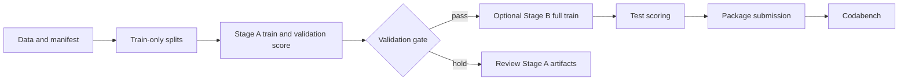

# ReVA experiment pipeline

This repository contains the reproducible ReVA training and scoring pipeline,
experimental code for temporal and spatial evidence, and selected audit
records for the ReVA Drone Video Understanding Challenge. Stage A Qwen3-VL-8B
is the frozen reference; later work includes frame-selection, grounding,
segmentation, retrieval, crop, visual-adaptation, and backbone-comparison
experiments. This checkout includes source, selected score files, and reports;
large clips, model weights, Hugging Face caches, checkpoints, and runtime
submissions stay under `WORK` on Sharanga.

## Experiment at a glance

The task is four-way video question answering. Each record contains one drone
clip, a question, and options A-D; the prediction is one option letter. The
public data used by this pipeline has 15,773 labelled train questions, 2,000
official validation questions, and 4,000 hidden-label test questions over
1,047 referenced clips. The released clips total about 1.37 GB. The test
videos overlap train videos, but test questions and answers are never copied
into training.

The frozen Stage A reference uses this recorded recipe:

| Setting | Stage A reference |
| --- | --- |
| Backbone | `Qwen/Qwen3-VL-8B-Instruct` |
| Model revision | `0c351dd01ed87e9c1b53cbc748cba10e6187ff3b` |
| Adaptation | LoRA r16, alpha 32, dropout 0.05 on language linear layers |
| Vision tower | Frozen in this first experiment |
| Frames | 16 per clip, sampled at up to 4 fps, with native-size token budget |
| Precision and attention | bf16 and PyTorch SDPA |
| Training | 2 epochs, micro-batch 1, gradient accumulation 16, cosine schedule |
| Validation | `fit_A` training source, `valT` video holdout, `valQ` question holdout |
| Scoring | Letter logits, two temporal offsets (`0`, `0.5`) and two cyclic option orders |

Recorded status:

- Stage A scores are `valQ` 498/595 (83.70%), `valT` 885/1,059 (83.57%), and
  official `val` 1,757/2,000 (87.85%).
- The endpoint sampler scored `valQ` 495/595, `valT` 890/1,059, and official
  `val` 1,755/2,000. The adaptive selector scored official `val` 1,745/2,000
  and is closed without promotion.
- The local Phase 8 H200-named run contains Qwen3.8-27B `valQ` scores of
  506/595 (85.04%) and partial `valT` scores of 558/658 (84.80%). The score
  rows identify revision `1d4bf0f2ff6012fd82039f2fa52739d0dd7c60c0`, but no
  score manifest or training-lineage record is present, so the directory name
  does not establish exact hardware or training settings.
- An earlier H100 validation-scoring snapshot (`407497`) recorded partial
  `valQ` metrics only. It is historical queue/log context, not current status;
  details and limits are in the [experiment ledger](docs/experiment_ledger.md).
- A later H100 test run, job `407542`, produced a validated package at
  `submissions/phase8_qwen38_h100_407542/submission.zip`. It contains 4,000
  unique A–D predictions and has not been uploaded to Codabench. SHA-256:
  `0784a48650189ddd673aaee4c45e71065248f7989f771e3135a33d102b4cca34`.
- The user reported a 4,000-pair evaluation at **83.75%** (3,350/4,000), with
  Temporal Grounding 75.0%, Change Detection 77.4%, and Geometric Relation
  86.5%. The prior private-test score recorded here is 3,358/4,000 (83.95%).
  These figures differ by 8 answers only if they use the same test set and
  scoring protocol. The new score's exact model lineage and same-ID prediction
  file are not present in this checkout, so this is not yet a controlled
  fine-tuning comparison.
- The previous `browser-harness` check found no active Chrome connection. The
  user said they would enable remote debugging; no upload has been recorded.

For the current experiment state, completed diagnostics, exact metrics, blocked
gates, and artifact links, see the [experiment ledger](docs/experiment_ledger.md).
For the source-code map, see [code and experiment index](docs/code_and_experiment_index.md).
This checkout has no usable Git history (`.git` is an empty directory), so these
documents describe artifacts currently present and cannot establish a precise
since-commit change list. No Stage B result artifact is present locally.

The completed Grounding DINO pilot scored 12/16 on `valQ` and 11/16 on `valT`,
matching the same-ID Stage A baseline on both selected splits; it was not
promoted. The Phase 3A two-video retrieval smoke remains exploratory: its
manual audit found category/frame-level retrieval gains for some car crops,
but no verified target-instance or cross-frame identity result. See the ledger
for denominators, limits, and the underlying manifests.

PyTorch SDPA is the required attention path. FlashAttention and vLLM are not
assumed: the installed versions may not support them, and this pipeline keeps
the same Transformers preprocessing for training and scoring. The GPU smoke
check below fails before a long job if the pinned model, processor metadata,
timestamps, bf16, or SDPA path is incompatible.

## Repository layout

```text
code/common.py              shared revisions, sampling, prompts, provenance
code/download_data.py       download JSONs and only referenced clips
code/build_manifest.py      decode and validate every referenced clip
code/make_splits.py         deterministic train-only fit_A/valT/valQ splits
code/train.py               resumable LoRA training and 50-step time estimate
code/score.py               resumable letter-logit scoring with TTA
code/build_feature_cache.py offline SigLIP2 candidate/query feature caches
code/build_grounding_cache.py offline Grounding DINO detections and 2D tracks
code/evaluate.py            holdout metrics and error tables
code/make_submission.py     schema checks and submission zip creation
code/smoke.py               short GPU compatibility and backward probe
code/configs/stageA.yaml    fit_A recipe
code/configs/stageB.yaml    full-train recipe after the Stage A gate
jobs/                       Slurm wrappers, dependencies, checkpoint recovery
tests/                      login-node unit and shell checks
```

Runtime files use this layout and are ignored by git:

```text
$WORK/
  data/ReVA/{train,val,test}.json and referenced clips
  data/manifest.json
  data/splits/{fit_A,valT,valQ,full_train}.json
  hf_cache/                 model and processor cache
  runs/stageA_q3vl8b_r16/   checkpoints, adapter, scores, manifests
  runs/stageB_q3vl8b_r16/   final adapter and test scores
  logs/ subs/               optional logs and submission zips
  envs/reva/                Python environment
```

## Setup on Sharanga

Use the source checkout on the login machine to populate the runtime tree.
Do not put data or model files in this repository.

```bash
export WORK=/scratch/ambpdc/soham/ReVA
mkdir -p "$WORK"/{data,hf_cache,runs,logs,subs,code,jobs,tests}
cp -a /path/to/ReVA/code /path/to/ReVA/jobs /path/to/ReVA/tests \
  /path/to/ReVA/requirements.txt /path/to/ReVA/requirements-torch.txt "$WORK"/
export HF_HOME="$WORK/hf_cache" HF_HUB_ENABLE_HF_TRANSFER=0
mkdir -p "$WORK/envs"
/apps/Amber24/amber24/miniconda/bin/python3.12 -m venv "$WORK/envs/reva"
source "$WORK/envs/reva/bin/activate"
python -m pip install --upgrade pip
```

Check the driver on an allocated H200 before choosing a PyTorch wheel. Keep
the CPU request at 12; the H200 QOS allows only 12 CPUs per user.

```bash
srun -p gpu_h200_8 --gres=gpu:nvidia_h200_nvl:1 -c 12 -t 0:05:00 \
  nvidia-smi --query-gpu=name,driver_version --format=csv
python -m pip install -r "$WORK/requirements-torch.txt"
python -m pip install -r "$WORK/requirements.txt"
hf download Qwen/Qwen3-VL-8B-Instruct \
  --revision 0c351dd01ed87e9c1b53cbc748cba10e6187ff3b
```

If the reported driver cannot run the default PyTorch wheel, install the
matching CUDA wheel index instead (for example `cu128` or `cu126`) and rerun
the dependency command. Do not install flash-attn just to satisfy a config:
the checked-in configs use SDPA.

## Data and provenance

The dataset revision is pinned in `code/common.py` and written to
`$WORK/data/dataset_revision.json`. Download and validate it on the login
node:

```bash
cd "$WORK"
python code/download_data.py
python code/build_manifest.py
python code/make_splits.py
```

`download_data.py` reads `train.json`, `val.json`, and `test.json`, computes the
allow-list of 1,047 referenced clips, rejects unsafe paths, and fails if
unreferenced raw `DJI_*.MP4` files appear. `build_manifest.py` decodes every
referenced clip and fails on a corrupt file. `make_splits.py` uses only
`train.json` with seed 0:

* `fit_A`: 14,119 questions;
* `valT`: 1,059 questions from held-out videos;
* `valQ`: 595 questions from held-out `(video, question)` groups;
* `full_train`: all 15,773 train questions.

The scripts assert disjoint IDs, video groups, and question groups. The
official `val.json` is never a training source.

## Verify before spending GPU time

Run the fast local checks from the source checkout or runtime tree:

```bash
python3 -m unittest discover -s tests -v
python3 -m py_compile code/*.py
bash tests/test_jobs.sh
```

Run the GPU probe in a short allocation. It loads the pinned processor and
model, checks A-D are single tokenizer tokens, checks timestamped prompts and
the assistant generation tag, performs a finite bf16 forward/backward pass on
representative sources including the largest native sample, and prints peak
memory and seconds per sample.

```bash
srun -p gpu_h200_8 --gres=gpu:nvidia_h200_nvl:1 -c 12 --mem=64G -t 0:15:00 --pty bash
source "$WORK/envs/reva/bin/activate"
cd "$WORK"
python code/smoke.py
```

Do not submit a long run if this probe fails. Its error identifies the missing
runtime capability or processor API instead of silently using a different
preprocessing path.



## Stage A: measure the recipe

Submit Stage A and its dependent scoring job from the runtime tree:

```bash
cd "$WORK"
bash jobs/pipeline.sh
```

The helper prints the training and scoring job IDs. Monitor only those IDs:

```bash
squeue -j <train_id>,<score_id>
sacct -j <train_id>,<score_id> --format=JobID,State,Elapsed,MaxRSS,ExitCode
tail -f reva_train_<train_id>.out
tail -f reva_score_<score_id>.out
```

Training saves checkpoints every 300 optimizer steps and resumes from the
newest checkpoint. A Slurm USR1 timeout requests a checkpoint and requeues the
same job. The training log prints timing after steps 1, 5, and 50, plus an
estimated total training duration. Scoring appends one complete JSON record at
a time, writes a manifest with adapter/model/data revisions and TTA settings,
truncates only a partial final record after a crash, and resumes safely.

When Stage A scoring finishes, evaluate all three labelled references:

```bash
for split in valQ valT val; do
  python code/evaluate.py \
    "runs/stageA_q3vl8b_r16/scores_${split}.jsonl" "$split"
done
```

The gate for the full retrain is an engineering target, not a claim about
the hidden test: `valQ >= 0.88`, `valT >= 0.78`, and official `val >= 0.82`.
Inspect the per-task output and letter histogram as well. If the gate fails,
keep the Stage A artifacts and diagnose them before spending time on Stage B.

## Stage B: documented full-train procedure

This is the gated procedure, not a report that Stage B completed. The current
local experiment ledger does not contain a Stage B adapter or result manifest.

`submit_stageB.sh` reruns the Stage A evaluations, checks the three thresholds,
and refuses to submit if any threshold is missing or below target. It then
submits the full-train adapter and dependent scoring job:

```bash
bash jobs/submit_stageB.sh
squeue -u "$USER"
```

After the test score file is complete, make and inspect the submission:

```bash
python code/make_submission.py \
  --scores runs/stageB_q3vl8b_r16/scores_test.jsonl \
  --out subs/stageB_tta
```

This checks all 4,000 unique test IDs, requires finite probabilities summing
to one, rejects suspicious letter bias, writes `predictions.json` inside the
primary zip, reopens the zip, and writes two alternative schemas for the
first Codabench format probe. The primary zip preserves the test metadata and
fills each row's `correct_answer` with the predicted letter. Submit only after
the platform's required schema is confirmed by the format probe.

## Scoring details and expected cost

For each question, `score.py` reads the same Qwen processor inputs as training,
gets the next-token logits for A-D, applies softmax over those four logits,
maps every cyclic option permutation back to the original letters, and averages
the views. The default is four forwards per question: offsets `0` and `0.5`
times two cyclic option orders. Use `--offsets` and `--rots` only after the
fast pass has produced evidence; they are recorded in the score manifest. The
default `legacy` frame sampler preserves the original index mapping. The
controlled `endpoints` ablation keeps the same 16-frame budget, includes the
first and final decoded frames in every offset view, shifts only interior
frames, and records `frame_sampling` in the score manifest. It is an inference
only experiment; it does not change training or the dataset.

Adaptive frame selection is a separate, opt-in path. It consumes an offline
feature cache. The cache builder uses
`google/siglip2-base-patch16-224` at immutable revision
`022b6f71160ffb0169ca4709e2d7e25be659598a`; it loads only from a caller-supplied
local snapshot with `local_files_only=True`. Each cache file is named by a
SHA-256 key over `video_checksum`, `encoder_revision`, `candidate_policy`, and
`preprocessing`, and contains this JSON-shaped data:

```json
{
  "schema_version": 1,
  "cache_key": "...",
  "video_checksum": "...",
  "encoder_revision": "google/siglip2-base-patch16-224@022b6f71160ffb0169ca4709e2d7e25be659598a",
  "candidate_policy": {"grid_algorithm": "uniform-endpoints", "grid_version": "candidate-grid-v1", "rate": 4.0, "cap": 64},
  "preprocessing": {"image_processor": "SiglipImageProcessor", "size": {"height": 224, "width": 224}, "feature_normalization": "l2"},
  "candidates": [{"frame_index": 0, "timestamp": 0.0, "feature": [0.1, 0.2]}],
  "query_features": {"qa_id": [0.3, 0.4]},
  "query_fingerprints": {"qa_id": "sha256-of-question-and-options"},
  "cache_content_digest": "sha256-of-this-record-without-the-digest"
}
```

Stage the exact snapshot manually before running the builder. The snapshot must
contain the model and processor files from the pinned revision, including
`config.json`, `model.safetensors`, `preprocessor_config.json`, and the tokenizer
files. The model page and revision are
[`google/siglip2-base-patch16-224@022b6f71160ffb0169ca4709e2d7e25be659598a`](https://huggingface.co/google/siglip2-base-patch16-224/tree/022b6f71160ffb0169ca4709e2d7e25be659598a).
After staging, set `SIGLIP2_DIR` to that local directory and write the exact
commit to `$SIGLIP2_DIR/.reva_encoder_revision`; the builder requires this
marker and rejects mismatches. It also checks every required staged file
against the immutable file-integrity manifest for that commit (HF Git blob
SHA-1 for regular files and the published SHA-256 for LFS files). The marker
is provenance only: changing any staged file causes validation to fail.

On an approved networked staging machine, the Hugging Face CLI equivalent is:

```bash
export SIGLIP2_DIR="$WORK/hf_cache/siglip2-base-patch16-224-022b6f7"
hf download google/siglip2-base-patch16-224 \
  --revision 022b6f71160ffb0169ca4709e2d7e25be659598a \
  --local-dir "$SIGLIP2_DIR"
printf '%s\n' 022b6f71160ffb0169ca4709e2d7e25be659598a \
  > "$SIGLIP2_DIR/.reva_encoder_revision"
```

Build one cache per referenced video and its questions on a machine with the
approved local Transformers environment:

```bash
python code/build_feature_cache.py \
  --split valQ \
  --model-dir "$SIGLIP2_DIR" \
  --feature-cache-dir runs/feature_cache
```

The builder creates the candidate image features and query text features; it
fails clearly when the staged files are absent and never downloads weights. It
holds an exclusive `.build_feature_cache.lock` in the cache directory for the
run; a concurrent builder exits with a busy error, so use one writer per cache
directory.
Then score it with a canonical output stem:

```bash
python code/score.py \
  --adapter runs/stageA_q3vl8b_r16/final_adapter \
  --split valQ \
  --adaptive-frames \
  --feature-cache-dir runs/feature_cache \
  --out runs/stageA_q3vl8b_r16/scores_valQ_adaptive.jsonl
```

On Sharanga, the cache and full validation scoring can be submitted as two
GPU jobs. The scoring job waits for cache generation and evaluates each split;
it requeues on the Slurm warning signal and resumes from completed question
records. The cache builder is safe to rerun because completed per-video caches
are reused.

```bash
cd /scratch/ambpdc/soham/ReVA
WORK="$PWD" sbatch jobs/adaptive_cache.sbatch valQ valT val
WORK="$PWD" sbatch --dependency=afterok:<cache_job_id> \
  jobs/adaptive_score.sbatch \
  runs/stageA_q3vl8b_r16/final_adapter valQ valT val
```

Both jobs default to one H200 GPU and write logs and artifacts under this
project. To run the same validation independently on H100, give it a separate
cache and output directory so parallel jobs cannot collide:

```bash
WORK="$PWD" REVA_FEATURE_CACHE_DIR=runs/feature_cache_h100 \
  REVA_ADAPTIVE_OUTPUT_DIR=runs/stageA_q3vl8b_r16/adaptive_h100 \
  sbatch -p gpu_h100_4 --gres=gpu:nvidia_h100_80gb_hbm3:1 \
  -J reva_cache_h100 -o reva_adaptive_cache_h100_%j.out \
  jobs/adaptive_cache.sbatch valQ valT val
WORK="$PWD" REVA_FEATURE_CACHE_DIR=runs/feature_cache_h100 \
  REVA_ADAPTIVE_OUTPUT_DIR=runs/stageA_q3vl8b_r16/adaptive_h100 \
  sbatch --dependency=afterok:<h100_cache_job_id> \
  -p gpu_h100_4 --gres=gpu:nvidia_h100_80gb_hbm3:1 \
  -J reva_adaptive_h100 -o reva_adaptive_score_h100_%j.out \
  jobs/adaptive_score.sbatch \
  runs/stageA_q3vl8b_r16/final_adapter valQ valT val
```

The adaptive outputs are separate from the endpoint and legacy baselines.

Adaptive scoring always writes the versioned sibling
`scores_valQ_adaptive.evidence.selector-v2.grounding-v1.jsonl`; the canonical
path remains available for a baseline run and is never overwritten.

The selector keeps uniform temporal anchors, fills remaining slots by cosine
query relevance with a spacing constraint, and records selected source-frame
indices and timestamps in every adaptive view. Each configured offset shifts
the interior anchors, while the shared cache remains per video. If strict
spacing cannot fill the 16-frame budget, the selector relaxes spacing in a
deterministic second pass; clips shorter than 16 frames repeat selected rows
to the same even frame count used by `common.sample_index_list` (with a
maximum of 16). Query fingerprints bind cached features to the question text
and options, so changed inputs cannot reuse the same `qa_id` feature. The
cache content digest is recomputed before use and recorded in every adaptive
view. Output timestamps are derived from the current manifest FPS and source
indices, rather than trusted from cache metadata.

Adaptive scoring requires the default `legacy` frame-sampling mode; combining
`--adaptive-frames` with `--frame-sampling endpoints` is rejected because the
adaptive offsets define their own anchor shifts. The requested `--out` path is
treated as a canonical stem and converted to a versioned evidence path
automatically, even when the canonical baseline file does not exist yet. The
same canonical path can later be used to create the baseline score.
Adaptive selection requires at least three anchors. Existing evidence files
must match their manifest. The builder's CPU default is deliberate; choose an
approved device only after measuring the cache-building cost and storage.

### Experiment status and evidence ledger

The adaptive-frame audit is closed. On the held-out `val` split, adaptive
frames scored 1,745/2,000 (87.25%) versus 1,757/2,000 (87.85%) for the saved
baseline, so adaptive selection is not promoted. The endpoint-inclusive
sampler is a separate completed diagnostic: it scored 495/595 on `valQ`,
890/1,059 on `valT`, and 1,755/2,000 on official `val`; it also remains
unpromoted.

The later grounding, segmentation, retrieval, geometry, crop, visual-adaptation,
and tracking records are diagnostic results with explicit gates and limits. The
Phase 3 SAM 3 comparison reached 24/32 versus 23/32 baseline on a selected
pilot, while the Phase 5 retrieved-crop arm tied the video-only baseline at
11/12. A1–A4 visual adaptation arms did not pass the recorded `valT` gate, and
Phase 7 cache validation did not find an independently assessable automatic
target track. These results do not replace the frozen Stage A reference.

Use the [experiment ledger](docs/experiment_ledger.md) for the full chronology,
result denominators, stale-status conflicts, and links to every decision report.
The remainder of this section documents the optional grounding implementation
and its fixed provenance contract; its presence is not a claim that the
grounding arm passed its promotion gate.

Stage the detector snapshot manually on an approved networked machine. The
grounding cache builder never downloads detector weights; the scorer keeps the
existing Stage A model-loading behavior:

```bash
export GROUNDING_DINO_DIR="$WORK/hf_cache/grounding-dino-tiny-a2bb814"
hf download IDEA-Research/grounding-dino-tiny \
  --revision a2bb814dd30d776dcf7e30523b00659f4f141c71 \
  --include "*.json" \
  --include vocab.txt \
  --include model.safetensors \
  --local-dir "$GROUNDING_DINO_DIR"
printf '%s\n' a2bb814dd30d776dcf7e30523b00659f4f141c71 \
  > "$GROUNDING_DINO_DIR/.reva_detector_revision"
```

The model page documents the Transformers `AutoProcessor` plus
`AutoModelForZeroShotObjectDetection` flow:
[`IDEA-Research/grounding-dino-tiny`](https://huggingface.co/IDEA-Research/grounding-dino-tiny/tree/a2bb814dd30d776dcf7e30523b00659f4f141c71).
Build and score a deterministic pilot by passing the split-aware JSON manifest
(or newline-delimited QA IDs) or video paths. The cache builder reuses complete per-video caches and fails
before model loading when the staged snapshot is missing or any required file
size/digest differs from the immutable HF tree metadata; the revision marker is
provenance only.

The checked-in pilot manifest
[`tasks/phase3_grounding_pilot_ids.json`](tasks/phase3_grounding_pilot_ids.json)
contains 16 IDs per split: four temporal-grounding, four geometric-relation,
four object-count/location, and four mixed-task controls. Target strata use
fixed entity coverage for courts, fields, parking lots, pools, barns, and
boats, with deterministic hash fill; controls use the same hash ordering after
excluding those target tasks. The manifest records the sampling rule and its
limits. The scorer and cache builder accept this JSON file and select the
section matching `--split`.

```bash
export PILOT_IDS_FILE="$PWD/tasks/phase3_grounding_pilot_ids.json"
```

```bash
python code/build_grounding_cache.py \
  --split valQ \
  --model-dir "$GROUNDING_DINO_DIR" \
  --grounding-cache-dir runs/grounding_cache_stageA \
  --qa-ids-file "$PILOT_IDS_FILE" \
  --device cuda

python code/score.py \
  --adapter runs/stageA_q3vl8b_r16/final_adapter \
  --split valQ \
  --grounding-context \
  --grounding-cache-dir runs/grounding_cache_stageA \
  --qa-ids-file "$PILOT_IDS_FILE" \
  --out runs/stageA_q3vl8b_r16/scores_valQ_grounding.jsonl
```

Repeat both commands with `--split valT` and a separate output stem to run the
other half of the fixed pilot; the same JSON manifest selects its `valT` IDs.

The requested score stem becomes
`scores_valQ_grounding.grounding.detector-v1.jsonl`; legacy, endpoint, and
adaptive files are not reused. Before any full held-out run, hand-check object
misses, false positives, adjacent-frame associations, camera-motion cases,
runtime, and cache size. Promote the arm only if the predeclared pilot gate is
met: target-task improvement, no material paired overall loss, no systematic
control regressions, and no 3D/depth claim from 2D boxes alone.

To reproduce the completed endpoint ablation with the existing Stage A adapter,
use a new output path so the baseline score file stays untouched:

```bash
python code/score.py \
  --adapter runs/stageA_q3vl8b_r16/final_adapter \
  --split valQ \
  --frame-sampling endpoints \
  --out runs/stageA_q3vl8b_r16/scores_valQ_endpoints.jsonl
python code/evaluate.py \
  runs/stageA_q3vl8b_r16/scores_valQ_endpoints.jsonl valQ
```

The endpoint ablation has been run and is retained under
`runs/stageA_q3vl8b_r16/`: `valQ` is 495/595 (83.19%), `valT` is 890/1,059
(84.04%), and official `val` is 1,755/2,000 (87.75%). It remains a diagnostic
sampler comparison and is not a leaderboard or top-3 claim; the full chronology
and limitations are in the [experiment ledger](docs/experiment_ledger.md).

The first benchmark is expected to fit comfortably in the 12-hour GPU limit,
but the measured 50-step estimate in the training log is authoritative. A
typical six-second clip uses 16 frames; 640x360 clips and 640x640 clips share
the same explicit cap and processor token budget. Runtime varies with the
installed Transformers build, driver, and node. The repository does not claim
a fixed wall-clock time before the probe.

## Recovery and reproducibility

* A stopped training job resumes from `runs/.../checkpoint-*`; do not delete
  that directory while a dependent job is pending.
* A stopped scoring job resumes from the JSONL and requires the same manifest.
  To intentionally change TTA or adapter, choose a new output path.
* `common.py` pins model and dataset revisions. Score manifests record both,
  the split checksum, adapter checksum, offsets, rotations, frame sampling,
  and shard settings. Older manifests without `frame_sampling` remain valid
  for the default `legacy` mode.
* Keep runtime artifacts outside git. Commit only source, configs, jobs,
  tests, requirements, and documentation.

Known limits: the exact Codabench `predictions.json` schema is private until a
format probe succeeds; the model and processor must be present in the offline
Hugging Face cache; and the expected accuracies and GPU-hour estimates are
engineering targets that must be measured on Sharanga.
